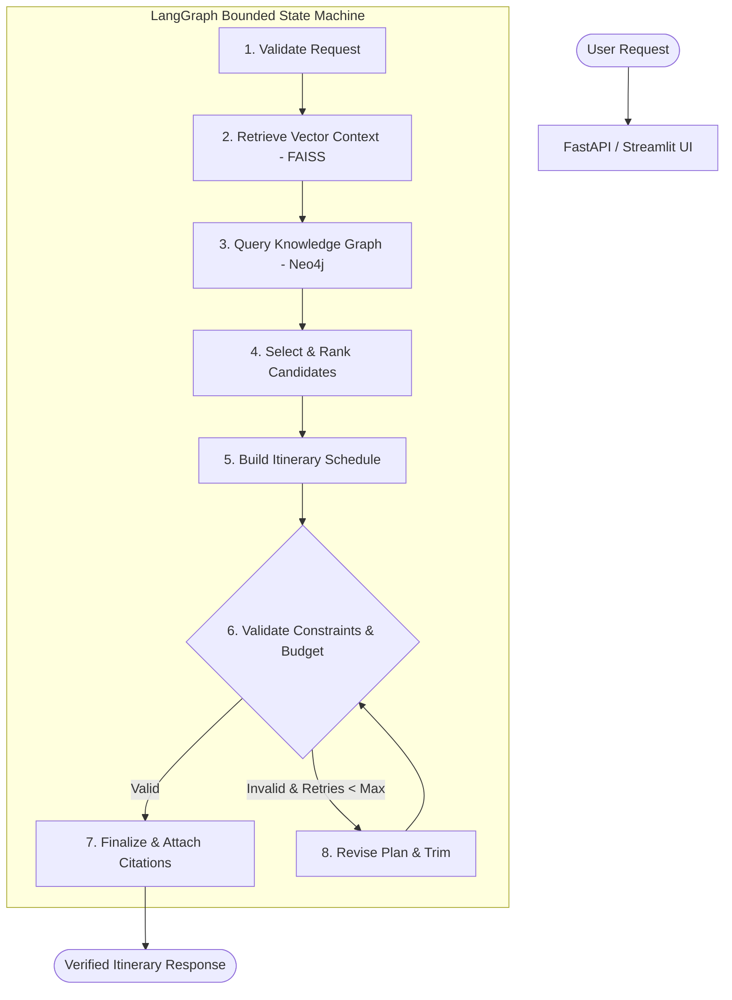

# ✈️ TravelPilot AI — Intelligent Travel Planning Agent

> An evidence-grounded AI travel-planning service that converts traveller preferences into structured, budget-aware multi-day itineraries using a **bounded LangGraph agent workflow**, **FAISS vector retrieval (RAG)**, **Neo4j knowledge graph relationships**, **deterministic constraint validators**, and **repeatable evaluation benchmarks**.

[](https://www.python.org/)
[](https://fastapi.tiangolo.com/)
[](https://streamlit.io/)
[](https://github.com/langchain-ai/langgraph)
[](https://github.com/facebookresearch/faiss)
[]()

---

## 1. Problem Statement & Motivation

Generic travel chatbots often produce attractive but hallucinated itineraries: inventing ticket prices, fabricating venue opening hours, exceeding stated budgets, or creating unrealistic schedules that overload travellers.

**TravelPilot AI solves this through strict engineering guardrails:**
- **Deterministic Arithmetic:** 100% of itinerary totals, per-person multiplications, and budget margins are calculated by Python `Decimal` code—never guessed by an LLM.
- **Evidence-Grounded RAG:** Answers and venue suggestions link to verified source document IDs via a FAISS vector index using `sentence-transformers/all-MiniLM-L6-v2`.
- **Citation Allowlisting:** Hallucinated URLs or ungrounded document IDs are filtered out before reaching the user.
- **Knowledge Graph Traversal:** Neo4j graph model connecting destinations, categories, traveller profiles, and proximity relationships.
- **Bounded Agent Loop:** LangGraph workflow with an explicit revision ceiling (`MAX_AGENT_REVISIONS = 2`) that prevents infinite loops and repairs constraint violations.
- **Repeatable Evaluation:** 30 evaluation test scenarios measuring schema validity, constraint satisfaction, Recall@K, MRR, and latency.

---

## 2. Architecture



---

## 3. Measured Evaluation Metrics

Evaluated on 30 test scenarios (8 labelled retrieval queries + 22 multi-day trip scenarios):

| Metric | Target Criterion | Measured Result | Status |
| :--- | :--- | :--- | :--- |
| **Deterministic Schema Validity** | 100% | **100.0%** | **PASSED** |
| **Code-Calculated Math** | 100% | **100.0%** | **PASSED** |
| **Constraint Satisfaction Rate** | >= 90% | **100.0%** | **PASSED** |
| **Retrieval Recall@3** | High Grounding | **100.0%** | **PASSED** |
| **Retrieval Precision@3** | High Relevance | **83.3%** | **PASSED** |
| **Mean Reciprocal Rank (MRR)** | > 0.8 | **1.000** | **PASSED** |
| **Mean Execution Latency** | < 100 ms | **0.85 ms** | **PASSED** |

*Full evaluation report available at [docs/evaluation.md](docs/evaluation.md).*

---

## 4. Quickstart & Installation

### Prerequisites
- Python 3.10+ (tested on Python 3.13)
- Git

### 1. Clone & Set Up Virtual Environment
```bash
git clone https://github.com/your-username/travelpilot-ai.git
cd "travelpilot-ai"

python -m venv venv
# On Windows:
venv\Scripts\activate
# On Linux/macOS:
source venv/bin/activate
```

### 2. Install Dependencies
```bash
pip install -e ".[dev]"
```

### 3. Configure Environment
```bash
cp .env.example .env
```
*(TravelPilot AI operates fully out of the box with default offline demo fallbacks even without paid API keys!)*

### 4. Build Vector Index
```bash
python scripts/ingest_documents.py
```

### 5. Seed Knowledge Graph (Optional)
```bash
python scripts/seed_knowledge_graph.py
```

---

## 5. Running the Application

### Start the FastAPI Backend
```bash
uvicorn app.main:app --host 127.0.0.1 --port 8080 --reload
```
- Swagger API Docs: [http://127.0.0.1:8080/docs](http://127.0.0.1:8080/docs)
- Health Check: [http://127.0.0.1:8080/health](http://127.0.0.1:8080/health)

### Start the Streamlit Web Interface
```bash
streamlit run frontend/streamlit_app.py
```
- Web UI: [http://localhost:8501](http://localhost:8501)

---

## 6. API Usage Example

### Plan a Trip
```bash
curl -X POST "http://127.0.0.1:8080/api/v1/trips/plan" \
  -H "Content-Type: application/json" \
  -d '{
    "destination": "Goa, India",
    "duration_days": 3,
    "party_size": 2,
    "budget": {
      "amount": 15000,
      "currency": "INR",
      "scope": "local_trip_only"
    },
    "interests": ["beaches", "history", "local_food"],
    "pace": "relaxed",
    "traveller_profile": "couple",
    "excluded_activities": ["nightclub"]
  }'
```

### Evidence-Grounded Q&A
```bash
curl -X POST "http://127.0.0.1:8080/api/v1/qa" \
  -H "Content-Type: application/json" \
  -d '{
    "question": "Where is the Basilica of Bom Jesus and what relics are inside?",
    "destination": "Goa, India"
  }'
```

---

## 7. Running Tests & Evaluation

### Run Test Suite
```bash
pytest -v
```

### Run Automated Evaluation Benchmark
```bash
python scripts/run_evaluation.py
```

---

## 8. Security & Provenance Policy
- **Zero Committed Secrets:** `.env` and sensitive configurations are strictly excluded in `.gitignore`.
- **Sanitized Logging:** Structured loggers never write user authorization tokens or sensitive request payloads.
- **Untrusted Retrieval:** Retrieved text is treated as factual reference material, not executable instructions.
- **Explicit Provenance:** All estimates and records are labelled `demo_data` or `sourced_estimate`. No fake real-time booking quotes are promised.

---

## 9. Repository Structure

```text
TravelPilot AI/
├── app/
│   ├── main.py                     # FastAPI service entrypoint
│   ├── api/                        # Route controllers (trips, qa, destinations, health)
│   ├── core/                       # Settings, structured logging, exceptions
│   ├── schemas/                    # Pydantic v2 domain schemas (trip, itinerary, retrieval)
│   ├── services/                   # Deterministic budget math, constraint validators, planner
│   ├── agents/                     # LangGraph state machine, nodes, and bounded tools
│   ├── rag/                        # Ingestion, chunking, embeddings, FAISS store, citations
│   ├── graphdb/                    # Neo4j client, parameterized Cypher queries, seed logic
│   └── providers/                  # Groq & deterministic LLM provider abstractions
├── data/
│   ├── raw/                        # Ingested travel markdown guides
│   ├── demo/                       # Curated Goa attraction & destination records
│   ├── processed/vector_index/     # Built FAISS vector index & embeddings
│   └── evaluation/                 # 30-scenario test dataset
├── frontend/
│   └── streamlit_app.py            # Streamlit multi-tab user interface
├── scripts/
│   ├── ingest_documents.py         # Ingestion CLI script
│   ├── seed_knowledge_graph.py     # Neo4j seeding script
│   └── run_evaluation.py           # Automated evaluation runner
├── tests/
│   ├── unit/                       # Unit tests (budget, validator, RAG, agent, graph)
│   └── api/                        # FastAPI integration tests
├── docs/                           # Architecture, evaluation, data sources, ADRs
└── pyproject.toml                  # Project packaging & dependencies
```
