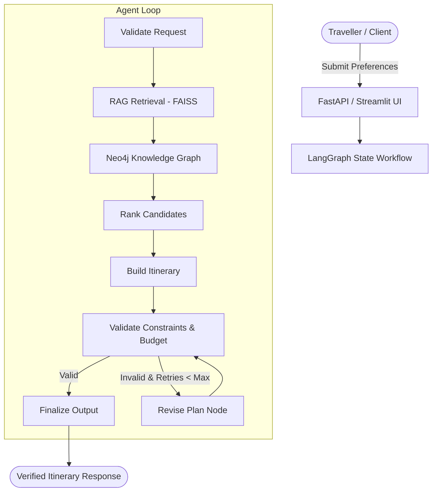
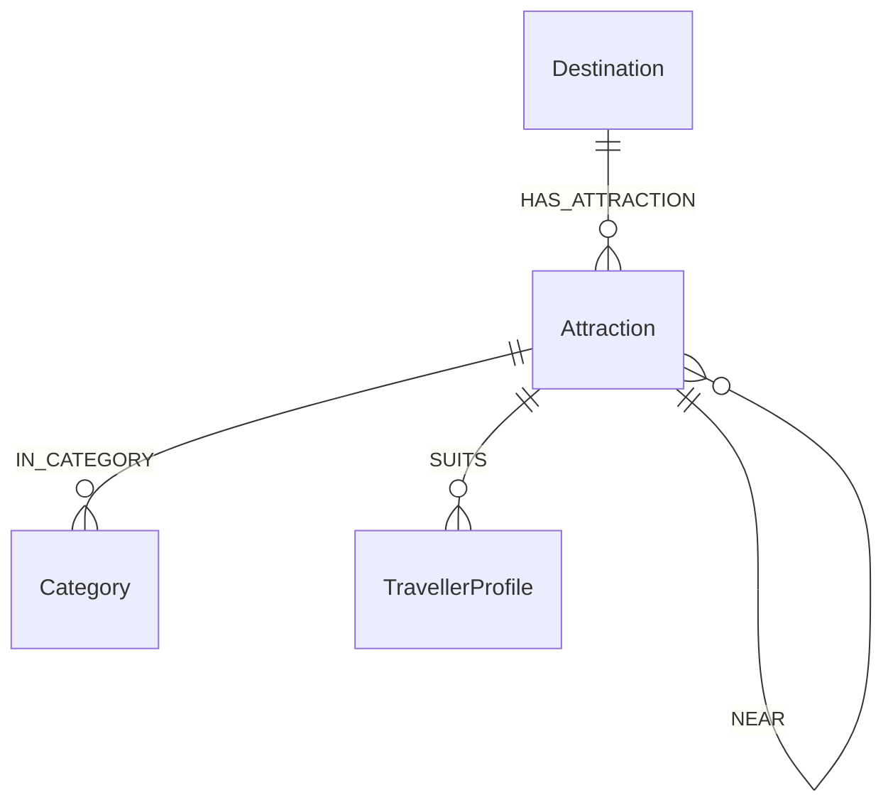

# TravelPilot AI — System Architecture & Design

## 1. Architectural Overview

TravelPilot AI is designed with clean separation of concerns across four primary pillars:
1. **API & Interface Layer:** FastAPI service (`app/api/`) and Streamlit web interface (`frontend/`).
2. **Deterministic Domain Core:** Exact budget calculations in `Decimal` arithmetic (`app/services/budget_calculator.py`), constraint verification (`app/services/itinerary_validator.py`), and recommendation ranking (`app/services/recommendation.py`).
3. **Retrieval-Augmented Generation (RAG):** Document chunking, SentenceTransformer vector embeddings (`all-MiniLM-L6-v2`), FAISS vector index, and citation allowlisting (`app/rag/`).
4. **Agent Workflow & Graph Database:** LangGraph bounded state graph with revision feedback loops (`app/agents/`) and Neo4j graph schema for attraction proximity and suitability relationships (`app/graphdb/`).

---

## 2. RAG Flow & Citation Verification

Retrieved passages are processed through an explicit evidence verification pipeline:
1. **Ingestion & Frontmatter Parsing:** Markdown documents from `data/raw/` contain structured frontmatter (`id`, `title`, `category`, `destination`, `data_status`).
2. **Chunking:** `DocumentChunker` segments documents into 500-character windows with 100-character overlap, maintaining deterministic `doc_id_chunk_N` identifiers.
3. **Embeddings:** `SentenceTransformer` encodes text into 384-dimensional normalized vectors.
4. **FAISS Vector Store:** `IndexFlatIP` computes cosine similarities.
5. **Citation Allowlisting:** `CitationValidator` ensures that any citation presented to the user corresponds strictly to a retrieved source ID. Hallucinated URLs or IDs are rejected.

---

## 3. Knowledge Graph Schema (Neo4j)

- **Nodes:**
  - `(:Destination {id, name, country})`
  - `(:Attraction {id, name, category, duration_minutes, cost, data_status})`
  - `(:Category {name})`
  - `(:TravellerProfile {name})`
- **Parameterized Cypher Execution:** All graph queries use parameters (e.g., `$destination`, `$category`, `$limit`) to guarantee SQL/Cypher injection immunity.
- **In-Memory Graph Fallback:** When Neo4j credentials are not configured or offline, `TravelGraphQueries` uses cached relational relationships.

---

## 4. Deterministic Planning & Budget Math

Unlike generic LLM wrappers that let models hallucinate arithmetic sums:
- Every activity cost: `group_cost = per_person_cost * party_size` computed using `Decimal`.
- Day totals: `sum(group_cost)`.
- Grand total: `sum(day_totals)`.
- Completeness status: explicitly reported as `complete`, `partial` (if any costs are unknown), or `unknown`.
