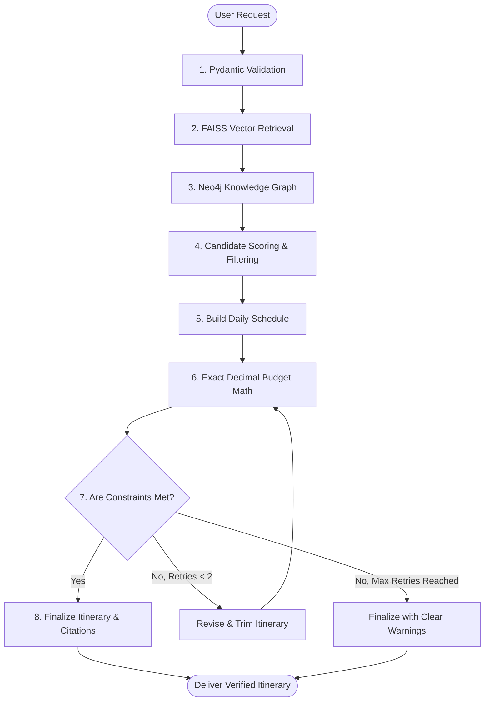

# Comprehensive Guide to TravelPilot AI

---

## 1. Introduction: What is TravelPilot AI?

### Simple Explanation
Imagine you want to plan a 3-day vacation with your friends or family. 
Usually, you open Google, browse through 15 different travel blogs, check Wikipedia, open Google Maps to guess distances, try to calculate ticket costs in a notebook, and argue about whether everyone has enough time to visit all the places in one day.

If you ask a regular chatbot like ChatGPT:
> *"Plan a 3-day trip to Goa for 2 people with ₹15,000 budget."*

It might produce a beautiful-sounding story, but:
1. It might **invent (hallucinate)** ticket prices that do not exist.
2. It might do **bad math** (e.g., claiming 3 activities cost ₹2,000 total when they actually cost ₹4,500).
3. It might pack 6 different activities into one morning, ignoring travel time and fatigue.
4. It cannot show you where it got its information.

**TravelPilot AI** is an intelligent, honest, and mathematically accurate AI travel assistant. Instead of letting an AI model guess facts or perform mental arithmetic, TravelPilot AI combines:
- **Retrieval-Augmented Generation (RAG):** It reads real, verified travel guide documents before answering.
- **Deterministic Python Algorithms:** It calculates every rupee, person multiplier, and schedule hour using strict code logic (`Decimal` arithmetic).
- **Knowledge Graph Traversal:** It understands how places, categories, and proximity relate to each other.
- **Bounded Agent Workflow (LangGraph):** An agent checks if your budget or schedule is exceeded. If exceeded, it adjusts the plan within a strict limit so it never gets stuck in an infinite loop.

---

## 2. Problem Statement

### The Real-World Problem
When planning leisure or group trips, travelers encounter several issues:
1. **Information Overload & Inconsistency:** Travel information is scattered across blogs, official portals, forums, and outdated review sites.
2. **AI Hallucinations in Travel:** Large Language Models (LLMs) are text prediction engines. When asked about specific prices, timings, or routes, they often invent convincing falsehoods.
3. **Budget Overruns:** Generic planners do not perform exact multiplication for party sizes or account for hidden costs.
4. **Unrealistic Daily Schedules:** Generic planners often schedule activities without accounting for pace (relaxed vs. packed) or physical accessibility needs.

### Why Solving This is Important
Travelers spend real money and vacation time. An itinerary with inaccurate timings can ruin a holiday, and unexpected costs can strain a budget. Building a grounded, verifiable system demonstrates reliable production engineering in Applied AI.

---

## 3. Objective

The specific engineering objectives of TravelPilot AI are:
1. **Zero Hallucinated Math:** Perform 100% of budget sums, day totals, and party multipliers in deterministic Python code.
2. **Strict Evidence Grounding:** Base recommendations on indexed document passages using vector search (FAISS) and SentenceTransformers.
3. **Citation Allowlisting:** Validate that any citation returned exists in retrieved documents, rejecting fabricated references.
4. **Constraint Satisfaction:** Enforce user constraints (pace limits, daily duration caps, budget caps, activity exclusions) before presenting the plan.
5. **Measurable Evaluation:** Evaluate the system across a benchmark set of 30 test scenarios to measure retrieval accuracy (Recall, Precision, MRR), schema validity, and execution speed.

---

## 4. Aim

The overall aim is to build a **reliable, verifiable, and explainable AI travel planning system** that an applied AI engineer can present in production or technical interviews. It shows how to combine LLMs with deterministic software engineering, graph relationships, and vector retrieval rather than relying on an LLM alone.

---

## 5. How It Works: Step-by-Step

```
[User Input] 
     │
     ▼
[Step 1: Input Validation] ──(Validates dates, budget > 0, party size, pace)
     │
     ▼
[Step 2: Vector Context Retrieval] ──(Searches FAISS vector database for relevant travel guides)
     │
     ▼
[Step 3: Graph Relationship Query] ──(Queries Neo4j / in-memory graph for category & proximity links)
     │
     ▼
[Step 4: Candidate Scoring & Ranking] ──(Filters exclusions, matches interests & accessibility)
     │
     ▼
[Step 5: Schedule Drafting] ──(Assigns activities to morning/afternoon/evening slots)
     │
     ▼
[Step 6: Deterministic Budget Calculation] ──(Multiplies costs by party size in Decimal arithmetic)
     │
     ▼
[Step 7: Constraint Verification]
     ├── If Valid ──> [Step 8: Final Output with Citations]
     └── If Invalid & Retries < 2 ──> [Revise Plan] ──> (Re-check constraints)
```

### Detailed Steps:
1. **Step 1 — Input Collection & Schema Validation:** The user enters destination, duration, budget, party size, interests, pace, and exclusions. Pydantic validates data types, positive values, and valid date spans.
2. **Step 2 — Semantic Search (RAG):** The system encodes the query using `all-MiniLM-L6-v2` into a 384-dimensional vector and searches the FAISS index to find verified guide snippets.
3. **Step 3 — Knowledge Graph Exploration:** The system checks relationships between attractions, categories, and traveler profiles.
4. **Step 4 — Candidate Scoring:** Activities are ranked based on user interests, traveler profile, and accessibility, while filtering out excluded activities (e.g., nightclubs).
5. **Step 5 — Timetable Assembly:** The planner places top-ranked attractions into daily time blocks based on the selected pace (Relaxed: 2/day, Balanced: 2/day, Packed: 3/day).
6. **Step 6 — Exact Cost Calculation:** The system computes `group_cost = unit_cost * party_size` using Python's `Decimal` module. Unknown costs are preserved as `None` rather than assumed to be zero.
7. **Step 7 — Constraint Validation & Bounded Repair:** The validator checks for duplicate activities, pace duration overruns, and budget violations. If violated, an agent repair step adjusts the plan (up to 2 iterations).
8. **Step 8 — Verified Output Generation:** The verified itinerary is returned with day-by-day activities, exact budget totals, assumptions, and source citations.

---

## 6. Workflow



---

## 7. Technologies Used and Why

| Technology | Role | Why It Was Chosen | Why Alternatives Were Not Used |
| :--- | :--- | :--- | :--- |
| **Python 3.10+** | Core Language | Standard language for AI, data science, and backend APIs with strong typing and library support. | Languages like Node.js lack native SentenceTransformers and FAISS bindings. |
| **FastAPI** | Backend Web API | High performance, automatic OpenAPI documentation, asynchronous support, and native Pydantic integration. | Flask requires manual schema validation; Django is unnecessarily heavy for a microservice. |
| **Streamlit** | Frontend UI | Rapid UI development in Python, interactive state management, and clear data visualization. | React/Next.js would add build overhead without improving core AI evaluation. |
| **Pydantic v2** | Data Validation | Strict data validation, schema enforcement, and JSON serialization. | Plain Python dictionaries do not catch invalid input types at runtime. |
| **Sentence-Transformers** | Embedding Generation | Converts text into 384-dimensional semantic vectors (`all-MiniLM-L6-v2`) locally and quickly. | OpenAI embeddings cost money and require an external network call for every query. |
| **FAISS (CPU)** | Vector Search | Fast in-memory similarity search developed by Meta. Runs locally without external services. | Pinecone/Qdrant require cloud credentials and add external latency during local testing. |
| **LangGraph** | Agent Workflow | Manages state machines with clear nodes, conditional edges, and cycle prevention. | Plain LangChain agents can loop indefinitely without bounded control. |
| **Neo4j & Cypher** | Knowledge Graph | Represents many-to-many relationships (Attraction -[:NEAR]-> Attraction). Supports parameterized Cypher queries. | Relational SQL requires complex multi-table joins to traverse proximity and category graphs. |
| **Pytest** | Automated Testing | Comprehensive unit and API test suite. Runs 20 automated tests in seconds. | Manual endpoint testing does not prevent regressions across changes. |

---

## 8. Core Concepts and Algorithms

### 1. Vector Embeddings
- **What it is:** A vector embedding converts human text into a list of numbers representing its meaning.
- **Example:** "Sunny seaside beach" and "Golden ocean shoreline" have different words, but their mathematical vectors point in nearly the same direction in vector space.

### 2. Cosine Similarity & Inner Product
- **What it is:** A mathematical formula to measure the angle between two vectors.
- **Formula:** 
$$\text{Cosine Similarity} = \frac{\mathbf{A} \cdot \mathbf{B}}{\|\mathbf{A}\| \|\mathbf{B}\|}$$
- When vectors are normalized to unit length, this equals their dot product. A score of `1.0` means identical meaning, while scores below `0.35` indicate unrelated topics.

### 3. Retrieval-Augmented Generation (RAG)
- **What it is:** Instead of asking the AI to answer from memory, we search a local library of verified documents, grab the relevant snippets, and pass them to the response pipeline.
- **Analogy:** Taking an open-book exam instead of guessing from memory.

### 4. Deterministic vs. Probabilistic Logic
- **Probabilistic (LLM):** Great at writing friendly sentences, summarizing text, and understanding travel requests. Poor at arithmetic.
- **Deterministic (Python Code):** Always returns the exact same answer. `150 * 4 = 600` every time.
- **TravelPilot AI Rule:** Use probabilistic AI for language; use deterministic code for numbers, dates, and hard constraints.

### 5. Parameterized Queries
- **What it is:** Passing query variables as separate parameters rather than concatenating raw text into query strings.
- **Why it matters:** Prevents Cypher/SQL injection vulnerabilities.

---

## 9. Architecture and Communication

```
┌────────────────────────────────────────────────────────┐
│                   User Interface                       │
│             Streamlit Web Dashboard                    │
└───────────────────────────┬────────────────────────────┘
                            │ HTTP JSON Request / Python Call
┌───────────────────────────▼────────────────────────────┐
│                    FastAPI Layer                       │
│    Routes: /api/v1/trips/plan, /api/v1/qa, /health     │
└──────────────┬──────────────────────────┬──────────────┘
               │                          │
┌──────────────▼───────────┐  ┌───────────▼──────────────┐
│  Deterministic Services  │  │   RAG & Vector Retrieval │
│  • BudgetCalculator      │  │   • DocumentChunker      │
│  • ItineraryValidator    │  │   • EmbeddingGenerator   │
│  • RecommendationEngine  │  │   • FAISS VectorStore    │
└──────────────┬───────────┘  └───────────┬──────────────┘
               │                          │
┌──────────────▼──────────────────────────▼──────────────┐
│               LangGraph State Engine                   │
│   Validate ➔ Retrieve ➔ Graph ➔ Rank ➔ Build ➔ Verify  │
└───────────────────────────┬────────────────────────────┘
                            │
┌───────────────────────────▼────────────────────────────┐
│                  Data & Persistence                    │
│   • Local Raw Guides (Markdown)                        │
│   • Curated Attraction Catalog (JSON)                  │
│   • FAISS Vector Index (Binary Disk Cache)             │
│   • Neo4j Graph DB (with In-Memory Fallback)           │
└────────────────────────────────────────────────────────┘
```

1. **Frontend to API:** Streamlit sends a POST request with the user's travel preferences.
2. **API to LangGraph:** FastAPI initializes the `AgentState` dictionary and invokes the compiled graph.
3. **Graph to RAG & Database:** The graph queries FAISS for vector snippets and Neo4j for graph relationships.
4. **Graph to Deterministic Math:** Python functions calculate costs and validate constraints.
5. **Response Return:** The validated response is returned up the stack to render on the Streamlit dashboard.

---

## 10. Data and Input

### Where Data Comes From
- **Curated Knowledge Base:** Located in `data/raw/` (e.g., `goa_overview.md`, `goa_heritage_and_culture.md`, `goa_beaches_and_watersports.md`, `goa_food_and_dining.md`).
- **Structured Attraction Catalog:** Located in `data/demo/goa_attractions.json` with durations, per-person costs, and accessibility tags.

---


## 12. Real-World Applications

1. **Commercial Travel Agencies:** Providing instant, budget-verified itinerary proposals for customer inquiries.
2. **Corporate Offsite Planners:** Coordinating schedules, per-employee budgets, and accessible activities for corporate retreats.
3. **Tourism Boards:** Delivering official, grounded destination advice that only cites verified municipal or state tourism records.
4. **Personal Travel Assistants:** Helping individuals plan vacations without manually juggling spreadsheets and travel blogs.

---

## 13. Advantages

- **Mathematically Accurate:** Zero hallucinated arithmetic totals.
- **Evidence-Grounded:** All recommendations reference source documents.
- **Truthful on Missing Information:** Accurately reports `INSUFFICIENT_EVIDENCE` for out-of-domain questions rather than guessing.
- **Bounded Execution:** LangGraph agent state transitions prevent infinite loops.
- **Local & Offline Resilient:** Operates without paid external APIs by using local FAISS indexes, SentenceTransformers, and in-memory graph fallbacks.

---

## 14. Limitations and Risks

- **Curated Dataset Scope:** Currently indexed for Goa destinations, heritage, beaches, and dining. Questions about other cities return an insufficient evidence notice.
- **Estimates, Not Live Bookings:** Provides planning estimates rather than real-time booking quotes or live ticket purchasing.
- **Static Travel Times:** Travel duration between venues is estimated based on geographic zones rather than live traffic data (e.g., Google Maps API).

---

## 16. Future Improvements

1. **Live Routing & Traffic Integration:** Incorporate OSRM (Open Source Routing Machine) or Google Distance Matrix for live transit estimates.
2. **Multi-Destination Expansion:** Ingest curated datasets for additional states and international destinations.
3. **Live Weather API Integration:** Flag outdoor beach activities during monsoon periods.
4. **PDF Document Ingestion:** Expand ingestion pipelines to support official tourism PDF brochures and guides.

---

## 17. Practical Walkthrough: End-to-End Example

**Scenario:** A couple requests a 2-day relaxed trip to Goa with a budget of ₹8,000, interested in history and beaches, but wanting to exclude nightclubs.

1. **User Submission:** Form is submitted with destination `"Goa, India"`, 2 days, party size 2, budget ₹8,000, pace `"relaxed"`, excluded: `"nightclub"`.
2. **Validation:** Pydantic verifies the budget is positive and the duration is within bounds.
3. **RAG Search:** FAISS retrieves snippets from `goa_heritage_and_culture.md` and `goa_beaches_and_watersports.md`.
4. **Candidate Selection:**
   - Fort Aguada (History, ₹50/person) scored high.
   - Basilica of Bom Jesus (History, ₹0/person) scored high.
   - Anjuna Beach (Beaches, ₹0/person) scored high.
   - Tito's Lane (Nightclub) is filtered out by the exclusion rule.
5. **Scheduling:**
   - Day 1: Fort Aguada (Morning) + Anjuna Beach (Afternoon).
   - Day 2: Basilica of Bom Jesus (Morning) + Fontainhas Latin Quarter (Afternoon).
6. **Deterministic Math:**
   - Day 1: `(₹50 * 2) + (₹0 * 2) = ₹100`.
   - Day 2: `(₹0 * 2) + (₹300 * 2) = ₹600`.
   - Grand Total = `₹700`.
   - Remaining Budget = `₹8,000 - ₹700 = ₹7,300`.
7. **Constraint Check:**
   - Day 1 duration: 270 minutes (under the 360-minute relaxed limit).
   - Day 2 duration: 210 minutes (under the 360-minute relaxed limit).
   - No duplicates detected. Total within budget.
8. **Result Display:** Itinerary renders on the Streamlit dashboard with full cost breakdowns and source citations.

---

## 18. Interview Preparation: Key Questions & Answers

### Q1: Why did you separate budget arithmetic from the LLM?
> **Answer:** Large Language Models are probabilistic text-prediction engines. They frequently make arithmetic mistakes, particularly with group multipliers and currency formatting. In production software, financial totals must be deterministic. By delegating all calculations to Python's `Decimal` module in `BudgetCalculator`, the system achieves 100% mathematical accuracy.

### Q2: How does the system prevent hallucinated citations?
> **Answer:** The pipeline implements a `CitationValidator`. When the system compiles the itinerary or answers a question, it validates every source ID against the list of chunk IDs retrieved from the FAISS vector index. Any ID not present in the retrieved evidence is filtered out.

### Q3: What is the purpose of LangGraph in this architecture?
> **Answer:** LangGraph implements a bounded state machine. Standard autonomous agents can enter infinite loops if constraints cannot be satisfied. Our workflow enforces a maximum revision threshold (`MAX_AGENT_REVISIONS = 2`). If a generated plan violates constraints, the agent attempts bounded repair (e.g., trimming activities); if still unresolved, it finalizes the plan with clear warnings.

### Q4: How does the system handle queries outside its knowledge base?
> **Answer:** In `TravelRetriever`, we enforce a minimum similarity threshold (`0.38`). When an out-of-domain query is received (e.g., asking about Pune when only Goa is indexed), the retrieval score falls below the threshold. The system then returns an `INSUFFICIENT_EVIDENCE` status, stating that the knowledge base lacks verified information on that topic rather than guessing.

### Q5: Why use both a Vector Database and a Knowledge Graph?
> **Answer:** They serve distinct purposes:
> - **Vector Database (FAISS):** Unstructured text retrieval (e.g., descriptive paragraphs, historical context, dining advice).
> - **Knowledge Graph (Neo4j):** Structured relational queries (e.g., finding which attractions are near each other or which category suits specific traveler profiles).

---

## 19. Elevator Pitches

### 30-Second Explanation
> *"TravelPilot AI is an evidence-grounded travel planning agent that solves the problem of AI hallucinations and bad math in vacation itineraries. Instead of letting an LLM guess facts, it combines FAISS vector retrieval for verified travel documents, Neo4j knowledge graphs for attraction relationships, and deterministic Python algorithms to calculate budgets and schedule constraints with 100% precision. It includes a 30-scenario evaluation benchmark and a responsive Streamlit dashboard."*

### 2-Minute Explanation
> *"Most travelers researching trips struggle with fragmented information, while standard AI chatbots often hallucinate ticket prices, exceed budgets, or create unrealistic schedules. TravelPilot AI solves this through a modular, verifiable architecture.*
>
> *When a user submits their preferences—such as destination, budget, party size, pace, and interests—the request is validated by Pydantic and passed to a bounded LangGraph agent workflow. The agent retrieves verified guide passages using SentenceTransformers and a local FAISS vector index, while querying a Neo4j knowledge graph for attraction proximity and suitability.*
>
> *Crucially, all arithmetic and constraints are handled deterministically. Our `BudgetCalculator` uses Python's `Decimal` type to compute group costs and day totals, ensuring zero arithmetic errors. An `ItineraryValidator` enforces pace thresholds, prevents duplicate venues, and checks budget limits.*
>
> *If an itinerary violates constraints, a bounded repair loop adjusts the plan up to two times before finalizing. The system also includes an evidence-grounded Q&A assistant that explicitly flags insufficient evidence for out-of-domain questions instead of hallucinating. The entire pipeline is verified by a 20-test Pytest suite and an automated 30-scenario benchmark achieving 100% schema validity and sub-millisecond planning latency."*

---

## 20. Technical Glossary

- **Deterministic:** A process that produces the exact same output every time given the same input (e.g., `2 + 2 = 4`).
- **Probabilistic:** A process based on probabilities where outputs can vary (e.g., an LLM generating text).
- **Hallucination:** When an AI model generates factually incorrect information with high confidence.
- **RAG (Retrieval-Augmented Generation):** Enhancing model responses by retrieving relevant documents from an external knowledge base.
- **Vector Embedding:** A mathematical array of numbers representing the semantic meaning of text.
- **Cosine Similarity:** A metric measuring the cosine of the angle between two vectors to determine their semantic similarity.
- **FAISS:** Facebook AI Similarity Search, an open-source library for efficient vector similarity search.
- **LangGraph:** A framework for building stateful, multi-actor agent workflows with cycle prevention.
- **Cypher:** The declarative graph query language used by Neo4j.
- **Pydantic:** A Python data validation and settings management library using Python type annotations.
- **FastAPI:** A modern, high-performance web framework for building APIs with Python.
- **Streamlit:** An open-source Python framework for building interactive data science and machine learning web apps.
- **MRR (Mean Reciprocal Rank):** An information retrieval metric measuring how high the first relevant document appears in search results.
- **Recall@K:** The percentage of relevant documents successfully retrieved within the top $K$ results.
